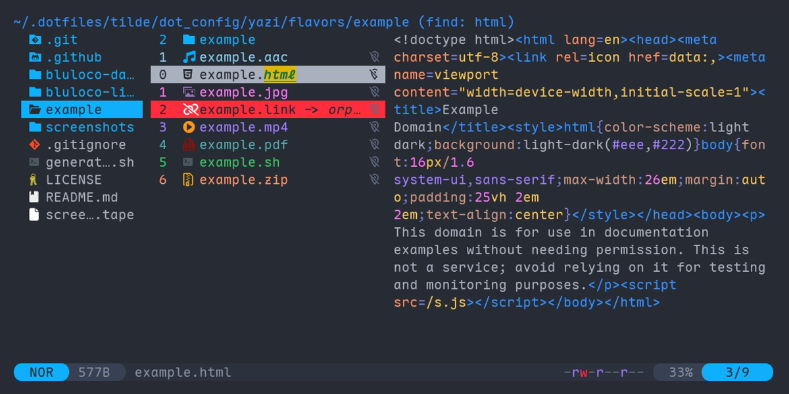

# Bluloco dark flavour for [Yazi]

## Preview

Files:



Spotter:

![Spotter][spotter]

Help:

![Help menu][help]

## Installation

```sh
ya pkg add hankertrix/bluloco-yazi:bluloco-dark
```

## Usage

Add the section below to your `theme.toml` file, located at
`~/.config/yazi/theme.toml` for Linux and macOS, and
`%AppData%\yazi\config\theme.toml` for Windows.

Note that this is a **dark** theme.

```toml
# ~/.config/yazi/theme.toml for Linux and macOS
# %AppData%\yazi\config\theme.toml for Windows
[flavor]
dark = "bluloco-dark"
```

## Licence

Both the flavour and the included `tmtheme` is licensed under the
[GNU Lesser General Public License v3 (LGPL v3)](LICENSE). Check the
[`LICENSE`](LICENSE) and [`LICENSE-tmtheme`](LICENSE-tmtheme) files for more
information.

<!-- Links -->

[Yazi]: https://github.com/sxyazi/yazi

<!-- Screenshots -->

[spotter]:
  https://github.com/user-attachments/assets/a1614f0a-60b2-4ba5-8ed9-e8d0fd39979d
[help]:
  https://github.com/user-attachments/assets/54225d23-a9bd-4b02-98d2-bb41451e21db
